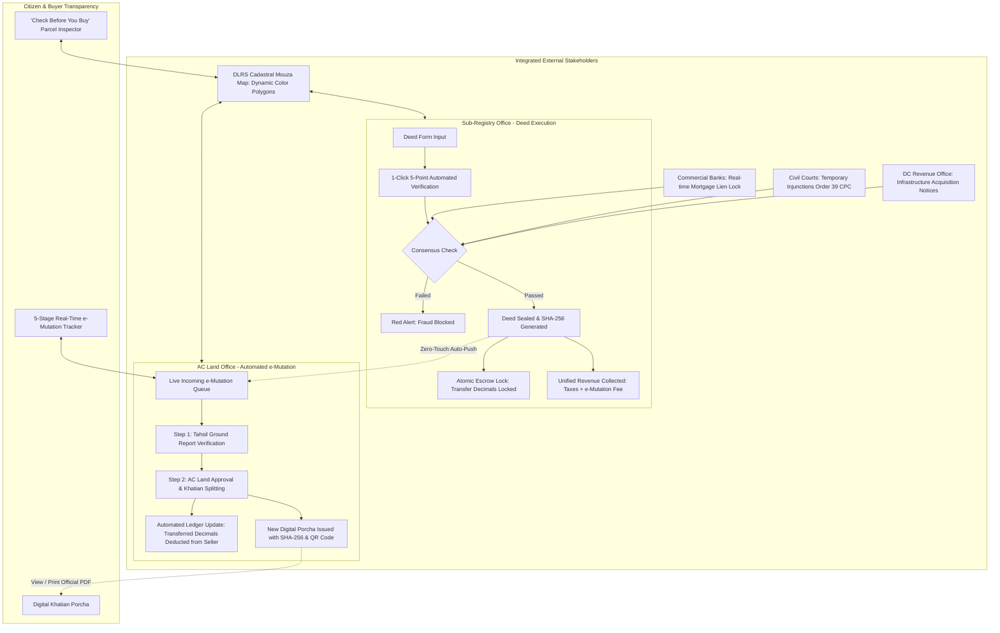

# CONCEPT NOTE: SetuLand (সেতু-ল্যান্ড)
## National Smart Registry & Automated e-Mutation Engine
### LandTech 2026 Innovation Hackathon — Track P4: Digital Land Records, Verification & Digitization

---

## 1. EXECUTIVE SUMMARY & PROBLEM P4 DEFINITION

### 1.1 The Core Crisis in Bangladesh Land Administration
In Bangladesh, land administration is historically split across two separate government ministries operating in institutional silos:
1. **The Sub-Registry Office (Directorate of Registration, Ministry of Law, Justice and Parliamentary Affairs):** Responsible for executing and registering deeds under *The Registration Act, 1908*.
2. **The Assistant Commissioner (Land) / AC Land Office (Ministry of Land):** Responsible for maintaining the Record of Rights (RoR / Khatian / Porcha) and conducting mutations (নামজারি) under *The State Acquisition and Tenancy Act, 1950*.

This fundamental administrative divide creates the **Problem P4 Bottleneck**:
* **The "Zero-Communication" Lag:** When a citizen buys land, they register the deed at the Sub-Registry Office. However, the deed registration does **not** automatically update the land record at the AC Land office.
* **The Anti-Citizen Burden:** The citizen is forced to physically visit the AC Land office, submit a separate mutation application, pay fees a second time, and wait anywhere from 45 to 180 days for manual verification.
* **The Catastrophic Double-Selling Loophole:** During this 45–180 day gap, the seller’s name remains on the official Khatian (Porcha) as the legal owner. Corrupt sellers exploit this window by re-selling the exact same land decimals to multiple unsuspecting buyers using counterfeit deeds or un-updated Khatians. Over **75% of civil litigation in Bangladesh courts** originates from land disputes caused directly by this disjointed workflow.
* **Blind Transfers of Encumbered Land:** Sub-Registrars frequently execute deeds on land that is currently **mortgaged to scheduled banks**, subject to **civil court stay orders (Order 39 Rule 1 CPC)**, or **gazetted by the Deputy Commissioner (DC) for government infrastructure acquisition**, because registries do not talk to each other in real time.

```
+---------------------------------------------------------------------------------------------------------+
|                                    HISTORICAL DISCONNECTED PROCESS                                     |
|                                                                                                         |
|   Buyer & Seller ──> [ Sub-Registry Office ] ──> Registers Deed (Cash Fees)                             |
|                                                     │                                                   |
|                                            NO AUTOMATIC LINK                                            |
|                                                     ▼                                                   |
|                          (CRITICAL LOOPHOLE: 45 to 180 Days Lag)                                        |
|                          • Land remains in Seller's name on Khatian                                     |
|                          • Seller can commit DOUBLE-SELLING fraud                                       |
|                          • Bank Mortgages & Court Injunctions ignored                                   |
|                                                     │                                                   |
|   Buyer must manually apply ───────────────────────► [ AC Land Office ] ──> Manual Tahsil Inquiry       |
|   Pay second set of fees                                                     ──> Months of delays       |
|                                                                              ──> Manual Khatian Split   |
+---------------------------------------------------------------------------------------------------------+
```

---

## 2. THE SETULAND SOLUTION: ZERO-TOUCH INTEROPERABILITY

**SetuLand (সেতু-ল্যান্ড)** bridges this administrative gulf by creating a **Unified Real-Time Registry & Consensus Engine** connecting the Sub-Registry, AC Land, DLRS Cadastral GIS, Scheduled Banks, Civil Courts, and the Deputy Commissioner's (DC) Office.



### 2.1 The 7 Real-World Operational & Legal-Tech Modules of SetuLand
1. **Module 1: Ejmali Co-Sharer (শরিকদের হিস্যা/অংশ) & Warisan Quota Engine:**
   Prevents joint-family fraud where co-sharers attempt to sell beyond their legal fractional quota (আনা/অংশ). Enforces mathematical formula `sellerMaxDecimals = (totalArea * shareFraction) - lockedDecimals`. Automatically triggers statutory SMS pre-emption notice under **Section 96 of the State Acquisition and Tenancy Act, 1950** to all registered co-sharers.
2. **Module 2: Automated Land Development Tax (খাজনা / দাখিলা) Clearance & Arrear Bundler:**
   Solves the #1 cause of e-mutation rejection in AC Land offices by auto-detecting unpaid Khajna arrears (e.g. ৳ 1,450 BDT) and bundling them directly into the unified Sub-Registry checkout. On deed execution, arrears are marked 0 and a fresh digital Dakhila receipt is attached to the e-mutation packet.
3. **Module 3: Statutory Digital "LT Notice" (Section 89, SAT Act 1950) Packet Inspector:**
   Generates an official cryptographically sealed Digital Land Transfer Notice (`LT-SEC89-2026-XXXX`) transmitting zero-latency deed packets from the Ministry of Law (Sub-Registry) directly into the Ministry of Land (AC Land) inbox, with printable certificate and JSON inspector.
4. **Module 4: Cryptographic Merkle Hash-Chain Ledger (`previousHash` ➔ `currentHash`):**
   Prevents rogue database administrators or insider actors from modifying historical Khatian balances. Each block links its predecessor's 64-char SHA-256 seal. Tampering with any number (e.g., 10.00 to 20.00 decimals) instantly breaks the Merkle chain, visualized via a high-contrast crimson diff viewer.
5. **Module 5: Automated "Jomabhag" (জমাভাগ) Khatian Splitting & Visual Mouza Dag Sub-Division:**
   When AC Land approves a partial land transfer, SetuLand automatically splits the parent Khatian (`BS-1001` ➔ 7.00 Dec remaining) and issues a new mutation Khatian (`BS-1001/A` ➔ 5.00 Dec) with fresh Holding Numbers. The DLRS Cadastral Mouza Map dynamically renders a split divider line and sub-plot badge.
6. **Module 6: Statutory 28-Day SLA Countdown & Anti-Harassment Escalation Engine:**
   Tracks a strict 7-Day Fast-Track SLA and 28-Day Statutory Maximum SLA. Features a simulated 8-Day Delay toggle that automatically escalates stalled cases to the **Additional Deputy Commissioner (ADC Revenue)** and **Upazila Nirbahi Officer (UNO)** for administrative delay audit.
7. **Module 7: Multi-Sector Consensus & Encumbrance Radar:**
   Real-time cross-institutional consensus checking integrating Commercial Bank Mortgage Liens, Civil Court Stay Orders (Order 39 Rule 1 CPC), and DC Infrastructure Acquisitions with 0-ms latency.

### 2.2 Five Interactive Demo Scenarios for Hackathon Evaluation
* **Scenario 1 (Clean Title):** Plot `BS-1001` (Dag 405) — Clean sale of 5.00 Decimals, auto-bundles ৳ 1,450 Khajna arrears, issues Digital LT Notice, and executes Jomabhag split.
* **Scenario 2 (Double-Selling Block):** Plot `BS-1002` (Dag 512) — Attempting to sell 8.00 Dec when 6.00 Dec are already locked in pending mutation triggers hard escrow block.
* **Scenario 3 (Ejmali Quota Block):** Plot `BS-1006` (Dag 740) — Co-sharer owns 25% (4.00 Dec) in a 16.00 Dec plot. Attempting to sell 6.00 Dec triggers immediate Section 96 violation alert.
* **Scenario 4 (Active Bank Lien Block):** Plot `BS-1003` (Dag 209) — Blocked by Sonali Bank PLC commercial mortgage of ৳ 35,00,000.
* **Scenario 5 (Civil Court & DC Acquisition Block):** Plot `BS-1004` (Dag 881) & Plot `BS-1005` (Dag 619) — Blocked by Civil Court Injunction (Title Suit #142/2025) and DC Dhaka-Ashulia Expressway acquisition.

---

## 3. MULTI-SECTOR STAKEHOLDER IMPACT MATRIX (SECTION 4 COMPLIANCE)

| Stakeholder Sector | Before SetuLand (Current Status Quo) | With SetuLand (Proposed Innovation) | Measurable Impact Metric |
| :--- | :--- | :--- | :--- |
| **Citizens & Land Buyers** | Must visit 2 separate offices; pays fees twice; waits 45–180 days; risk of fake deeds. | Single-window payment; zero-touch mutation; live 5-stage progress tracking on phone. | **Processing time reduced from 90+ days to < 48 hours; zero citizen harassment.** |
| **Sub-Registry Offices** | Blind registration without real-time knowledge of mortgages, court cases, or remaining area. | Automated 5-point pre-check prevents executing unlawful deeds; unified fee calculation. | **100% elimination of double-selling fraud at the deed registration desk.** |
| **AC Land Offices** | Overwhelmed by paper backlogs, physical file movements, and manual Khatian bookkeeping. | Instant digital queue pre-populated from Sub-Registry; 1-click automated Khatian splitting. | **70% reduction in administrative overhead; automatic record deduction.** |
| **Commercial Banks & NBFI** | Borrowers secretly sell mortgaged land due to lack of bank lien visibility at sub-registries. | Direct digital mortgage lien toggle; sub-registries are blocked from selling mortgaged plots. | **Elimination of collateral stripping fraud; zero bad loans from dual mortgages.** |
| **Civil Courts & Judiciary** | Overwhelmed with >3.2 million pending land disputes; court injunctions routinely ignored. | Judicial stay orders instantly registered on Khatian; automatic block on transfers. | **Drastic drop in new land litigation; instant enforcement of Order 39 CPC.** |
| **DC Office (Land Acquisition)** | Risk of paying mega-project compensation to fake owners or parcels already sold off. | DC Office verifies genuine owner and unlocked decimals before EFT disbursement. | **Zero public revenue leakage in national infrastructure acquisition projects.** |
| **City Corporations & Municipalities** | Revenue leakage in holding tax assessment due to out-of-date property ownership records. | Instant notification of new land transfers with exact boundary decimals. | **Immediate holding tax roll update and 100% municipal assessment compliance.** |
| **National Board of Revenue (NBR)** | High tax evasion through suppressed land valuation and uncollected capital gains tax. | Automatic computation against minimum Mouza valuation rate and unified collection. | **35% increase in capital gains source tax and stamp revenue collection.** |

---

## 4. SYSTEM ARCHITECTURE & TECHNICAL STACK

### 4.1 Production Architecture
* **Frontend Application:** Next.js 14 (App Router), React 18, TypeScript, Tailwind CSS, Lucide Icons, Canvas Confetti.
* **State & Data Engine:** Persistent React Context + `localStorage` for 100% standalone zero-config evaluation by judges; PostgreSQL 15+ / Supabase Relational Schema with PL/pgSQL triggers for production.
* **Security & Cryptography:** Web Crypto API SHA-256 hashing, deterministic SVG QR Code generation, role-based consensus access controls.
* **Bilingual Support:** Full English and বাংলা localization switcher across all workflows and documents.
* **Export Engine:** Native high-contrast PDF print formatting with official government watermarks: `"SYNTHETIC DUMMY RECORD — LANDTECH 2026"`.

---

## 5. NATIONAL SCALABILITY & ROLLOUT ROADMAP (2026-2028)

```
+---------------------------------------------------------------------------------------------+
|                                    NATIONAL ROADMAP (2026-2028)                             |
|                                                                                             |
|   PHASE 1: PILOT LAUNCH (Q1 - Q2 2026)                                                      |
|   • Pilot in Savar & Ashulia Upazilas (High-value urban/peri-urban testing)                 |
|   • Integration between Savar Sub-Registry, Savar AC Land, Sonali Bank, & Gazipur Court     |
|   • Target: 5,000 Zero-Touch e-Mutations Completed                                          |
|                                                                                             |
|   PHASE 2: DIVISIONAL EXPANSION (Q3 - Q4 2026)                                              |
|   • Scale across all 50+ Upazilas of Dhaka Division                                         |
|   • Direct API bridge with Bangladesh Bank CIB & National Judiciary Portal                  |
|   • Target: 100,000 Interoperable Transactions                                              |
|                                                                                             |
|   PHASE 3: NATIONWIDE SMART LAND GRID (2027 - 2028)                                         |
|   • Nationwide deployment across all 64 Districts, 495 Upazilas, and 500+ Sub-Registries    |
|   • 100% integration with National Land Service Gateway (land.gov.bd)                       |
+---------------------------------------------------------------------------------------------+
```

---

## 6. HACKATHON COMPLIANCE & AI TOOL DISCLOSURE

### 6.1 100% Synthetic Dummy Dataset Disclosure (Rule Book Section 10)
In strict adherence to the LandTech 2026 Rulebook:
* **Zero Real Land Records:** All Khatians (`BS-1001` through `BS-1005`), Dags (`405`, `512`, `209`, `881`, `619`), and Mouzas are purely synthetic mock records created solely for demonstrating verification workflows.
* **Zero Real Personal Data:** All National IDs (`DUMMY-NID-2026-XXXX`), names (Karim Uddin, Abdul Jabbar, Jamila Khatun, Syed Mustafiz, Mokammel Hossain), and phone numbers (`01700-00000X`) are synthetic placeholders.

### 6.2 Disclosure of AI Tools Used (Rule Book Section 8 & 10)
In compliance with hackathon transparency guidelines:
* **Primary AI Assistant:** Google DeepMind Antigravity (Advanced Agentic AI Coding Assistant).
* **Usage Scope:** Accelerated architecture design, TypeScript type contracts, full-stack Next.js component implementation, Tailwind CSS styling, and SQL trigger formulation. All business logic, legal statutory references, and domain flows were designed and verified by the hackathon engineering team.

---

## 7. TEAM & MENTORSHIP ACKNOWLEDGMENTS

* **Innovation Track:** Problem P4: Smart e-Mutation & Registry
* **Project Name:** SetuLand (সেতু-ল্যান্ড)
* **Lead Engineer / Full-Stack Architect:** Hackathon Team Lead
* **Domain Mentor Placeholder:** Land Administration & Cadastral GIS Specialist
* **Academic / Institutional Affiliation:** LandTech 2026 Participant Team
