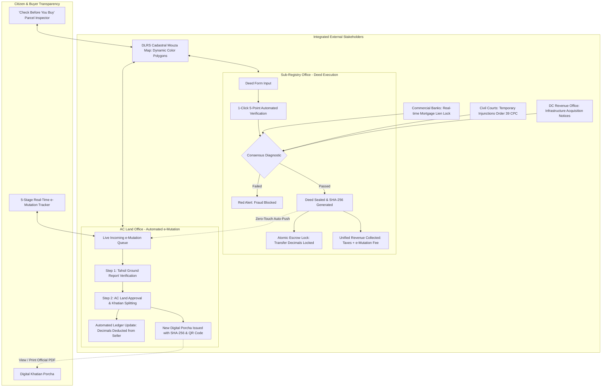

# SetuLand (সেতু-ল্যান্ড)
### National Smart Registry & Automated e-Mutation Engine
**LandTech 2026 Innovation Hackathon — Track P4: Digital Land Records, Verification & Digitization**

[](https://nextjs.org/)
[](https://www.typescriptlang.org/)
[](https://tailwindcss.com/)
[](https://opensource.org/licenses/MIT)
[](https://land.gov.bd)

---

## 🏛️ 1. Executive Summary & Problem P4 Definition

In Bangladesh, deed registration at the **Sub-Registry Office** (Directorate of Registration, Ministry of Law) and record mutation at the **AC Land Office** (Directorate of Land Records & Surveys, Ministry of Land) operate in disconnected institutional silos:
* **The "Zero-Communication" Lag:** When a citizen buys land, they register the deed at the Sub-Registry Office. However, the deed registration does **not** automatically update the land record at the AC Land office.
* **The Anti-Citizen Burden:** The citizen is forced to physically visit the AC Land office, submit a separate mutation application, pay fees a second time, and wait anywhere from 45 to 180 days for manual verification.
* **The Catastrophic Double-Selling Loophole:** During this 45–180 day gap, the seller’s name remains on the official Khatian (Porcha) as legal owner. Unscrupulous sellers exploit this window by re-selling the exact same land decimals to multiple unsuspecting buyers. Over **75% of civil litigation in Bangladesh courts** originates from land disputes caused directly by this disjointed workflow.
* **Blind Transfers of Encumbered Land:** Sub-Registrars frequently execute deeds on land that is currently **mortgaged to scheduled banks**, subject to **civil court stay orders (Order 39 Rule 1 CPC)**, or **gazetted by the Deputy Commissioner (DC) for infrastructure acquisition**, because registries do not interoperate in real time.

**SetuLand (সেতু-ল্যান্ড)** solves Problem P4 by creating a **Unified Real-Time Registry & Consensus Engine** connecting the Sub-Registry, AC Land, DLRS Cadastral GIS, Scheduled Banks, Civil Courts, and the Deputy Commissioner's (DC) Office.



---

### 🏛️ The 7 Real-World Operational & Legal-Tech Modules
1. **Module 1: Ejmali Co-Sharer (শরিকদের হিস্যা/অংশ) & Warisan Quota Engine:**
   Mathematically calculates the seller's personal sellable quota `sellerMaxDecimals = (totalArea * shareFraction) - lockedDecimals`. Blocks over-selling beyond fractional shares and dispatches statutory SMS pre-emption notices under **Section 96, SAT Act 1950**.
2. **Module 2: Automated Land Development Tax (খাজনা / দাখিলা) Clearance & Arrear Bundler:**
   Detects unpaid Khajna arrears (e.g. ৳ 1,450 BDT) and auto-bundles them into the Sub-Registry checkout, issuing a digital Dakhila attached to the AC Land e-mutation packet to guarantee 0% rejection.
3. **Module 3: Statutory Digital "LT Notice" (Section 89 SAT Act 1950) Packet Inspector:**
   Dispatches cryptographically sealed Digital Land Transfer notices directly to the AC Land office with 0-ms latency; includes interactive JSON packet inspector and official printable certificate.
4. **Module 4: Cryptographic Merkle Hash-Chain Ledger (`previousHash` ➔ `currentHash`):**
   Tamper-evident hash-chain linking each block. Includes a live integrity indicator and an interactive Tamper Simulator demonstrating how modifying even a single number breaks the Merkle chain with a high-contrast crimson diff viewer.
5. **Module 5: Automated "Jomabhag" (জমাভাগ) Khatian Splitting & Visual Mouza Dag Sub-Division:**
   Splits parent Khatian (`BS-1001` ➔ 7.00 Dec) and creates mutation Khatian (`BS-1001/A` ➔ 5.00 Dec) with fresh Holding numbers, rendering a dynamic split divider line and sub-plot badge on the interactive DLRS Mouza GIS map.
6. **Module 6: Statutory 28-Day SLA Countdown & Anti-Harassment Escalation Engine:**
   Tracks a 7-day fast-track SLA and 28-day statutory maximum. Features a "Simulate 8-Day Delay" button that auto-escalates cases to the **Additional Deputy Commissioner (ADC Revenue)** and **UNO** for delay audit.
7. **Module 7: Multi-Sector Consensus & Encumbrance Radar:**
   Real-time cross-institutional consensus checking integrating Bank Mortgage Liens, Civil Court Stay Orders (Order 39 Rule 1 CPC), and DC Infrastructure Acquisitions.

---

## ⚡ 2. 60-Second Quick Start (Run Locally)

SetuLand is engineered to run 100% out-of-the-box with **zero external API keys or cloud dependencies**. All state is managed via a persistent React Context + `localStorage` engine pre-seeded with rich synthetic dummy data.

```bash
# 1. Clone the repository
git clone https://github.com/BornilMahmud/-landtech-la-135.git
cd -landtech-la-135

# 2. Install dependencies
npm install

# 3. Start local development server
npm run dev

# 4. Open in browser
# Visit http://localhost:3000
```

### Production Build Verification
```bash
npm run build
npm run start
```

---

## 🧑‍⚖️ 3. 5 One-Click Demo Scenarios (Judge Quick Tour)

Test each scenario directly on `http://localhost:3000` via the top Scenario Pills in the Sub-Registrar Portal:

1. **Scenario 1: `[✅ Scenario 1: Clean Sale + Auto Khajna + Digital LT Notice (BS-1001)]`**
   * Inspect clean title (12.00 Decimals). Note ৳ 1,450 Khajna Arrears auto-bundled into checkout.
   * Click **"✍️ Register Deed, Lock Area & Auto-Trigger e-Mutation"**.
   * View the official **Digital Deed Receipt** and click **"📄 View Statutory Digital LT Notice"** to inspect the cryptographically signed Section 89 packet.
2. **Scenario 2: `[🛑 Scenario 2: Double-Selling / Locked Area Fraud Block (BS-1002)]`**
   * Check #3 flashes crimson: 7.00 of 10.00 Decimals are already locked in `MUT-2026-5001`. Attempting to sell 6.00 decimals is blocked immediately.
3. **Scenario 3: `[👨‍👩‍👧‍👦 Scenario 3: Ejmali Co-Sharer Over-Selling Quota Block (BS-1006)]`**
   * Joint plot has 16.00 Decimals, but seller Karim Uddin owns only 25% (4.00 Dec).
   * Attempting to sell 6.00 Decimals triggers the **🛑 EJMALI QUOTA VIOLATION** blocker.
   * Selling 4.00 Decimals or less passes and triggers the **Section 96 Pre-Emption SMS Notice** to co-sharers Mokammel Hossain and Jamila Khatun.
4. **Scenario 4: `[🏦 Scenario 4: Active Bank Mortgage Lien Block (BS-1003)]`**
   * Blocked by active Sonali Bank PLC mortgage lien (BDT 3,500,000). Check #4 fails.
5. **Scenario 5: `[⚖️ Scenario 5: Civil Court Injunction & DC Acquisition Block (BS-1004)]`**
   * Blocked by Civil Court Stay Order in Title Suit #142/2025. Check #5 fails.

### AC Land & SLA Delay Simulation Tour:
* Switch to **`⚡ AC Land Office`**:
  - Notice the **⏱️ Fast-Track SLA: Day 1 of 7** countdown badge.
  - Click **"⏳ Simulate 8-Day Office Delay"** to witness automated escalation to ADC (Revenue) and UNO.
  - Inspect the Jomabhag Split mathematical proof and click **"✅ Approve e-Mutation & Execute Jomabhag Split"**.
  - Open the **DLRS Cadastral Mouza Map** to see the dynamic split divider line and sub-plot badge.

---

## 📊 4. Pre-Seeded Synthetic Dataset (100% Synthetic Dummy Data)

| Plot ID | Khatian No | Dag No | Mouza | Total Decimals | Locked Decimals | Status / Demo Scenario |
| :--- | :--- | :--- | :--- | :--- | :--- | :--- |
| `plot-1` | `BS-1001` | `405` | Savar | 12.00 Dec | 0.00 Dec | **Clean Title & Khajna Clearance.** ৳ 1,450 arrears auto-bundled into checkout. Digital LT Notice issued. Owner: Karim Uddin (`DUMMY-NID-2026-1001`). |
| `plot-2` | `BS-1002` | `512` | Ashulia | 10.00 Dec | **7.00 Dec** | **Double-Selling Prevention.** 7 decimals already locked in `MUT-2026-5001`. Selling 6 decimals triggers fraud alert! Owner: Abdul Jabbar (`DUMMY-NID-2026-1002`). |
| `plot-3` | `BS-1003` | `209` | Birulia | 8.50 Dec | 0.00 Dec | **Bank Mortgage Lien.** Active mortgage with Sonali Bank PLC (BDT 3,500,000). Triggers mortgage block! Owner: Jamila Khatun (`DUMMY-NID-2026-1003`). |
| `plot-4` | `BS-1004` | `881` | Dhamsona | 15.00 Dec | 0.00 Dec | **Civil Court Injunction.** Active stay order in Case #`DUMMY-CIV-404/2026`. Triggers judicial dispute block! Owner: Syed Mustafiz (`DUMMY-NID-2026-1004`). |
| `plot-5` | `BS-1005` | `619` | Ashulia | 20.00 Dec | 0.00 Dec | **Lineage Mismatch & DC Acquisition.** Broken RS-to-BS title succession and active notice for Dhaka-Ashulia Elevated Expressway. Owner: Mokammel Hossain (`DUMMY-NID-2026-1005`). |
| `plot-6` | `BS-1006` | `740` | Ashulia | 16.00 Dec | 0.00 Dec | **Ejmali Co-Sharer Quota & Sec 96 Notice.** 3 co-sharers (25%, 25%, 50%). Selling > 4.00 Dec blocked. Sec 96 Pre-Emption SMS dispatched. |

---

## 🗄️ 5. Relational Database Schema (`database/schema.sql`)

The application state directly mirrors a production **PostgreSQL 15+ / Supabase** schema located in `database/schema.sql`:
* `citizens`: National ID, biometric verification mock, names in English & বাংলা.
* `khatian_records`: Master Record of Rights with institutional locks and SVG GIS coordinates.
* `lineage_records`: Historical CS ➔ SA ➔ RS ➔ BS title nodes with verification flags.
* `deeds`: Sub-Registry deed execution records with unified tax breakdowns and SHA-256 seals.
* `mutations`: AC Land workflow stages from auto-dispatch to approval.
* `audit_logs`: Immutable cryptographically chained audit ledger with `prev_hash ➔ current_hash`.
* **Automated Database Triggers:**
  - `trg_lock_area_on_deed()`: Raises exception if requested transfer exceeds available area and automatically increments `locked_area_decimals`.
  - `trg_execute_khatian_split()`: Automatically deducts decimals from parent Khatian and marks mutation completed upon approval.

---

## ⚠️ 6. Hackathon Compliance Notice (Rule Book Section 10)

* **Compliance Mode:** In accordance with LandTech 2026 rules, this application operates strictly with **100% Synthetic Dummy Data**.
* **Zero Real Personally Identifiable Information:** All names, National IDs (`DUMMY-NID-2026-XXXX`), phone numbers (`01700-00000X`), and land records are synthetic mock representations.
* **Persistent Compliance Banner:** A persistent dark-slate legal compliance banner is present throughout the entire user interface.

---

## 🤖 7. Disclosure of AI Tools Used (Rule Book Section 8 & 10)

In accordance with LandTech 2026 Hackathon Rulebook transparency guidelines:
* **AI Tool Employed:** Google DeepMind Antigravity (Advanced Agentic AI Coding Assistant).
* **Scope of Assistance:** Acceleration of TypeScript definitions, Next.js component creation, Tailwind layout styling, and PostgreSQL schema trigger drafting.
* **Human Engineering:** System architecture, legal workflow alignment with the *Registration Act 1908* and *State Acquisition and Tenancy Act 1950*, anti-double-selling escrow logic, statutory compensation formulas under *ARIPA 2017*, and test cases were designed and validated by the hackathon engineering team.

---
# -landtech-la-135
