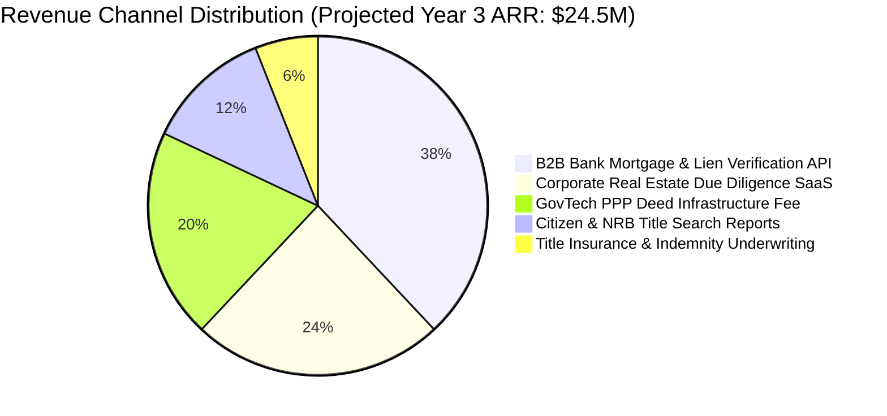

# SetuLand & LandWise: Business Proof, Monetization & ROI Analysis

> **Financial Viability, Market Sizing, Monetization Architecture & Commercial ROI**  
> *Track P4: Digital Land Records, Verification & Cadastral Digitization (LandTech 2026)*

---

## 1. Executive Summary: Why This Platform Is Business-Proof & High-Margin

Many GovTech or PropTech initiatives fail because they rely solely on non-recurring government grants without an autonomous commercial engine. **SetuLand & LandWise** is engineered as a high-margin, dual-sided B2B SaaS and GovTech infrastructure platform designed for financial self-sustainability, high enterprise cash flows, and public utility.

The commercial thesis is anchored in five undeniable market dynamics:
1. **The Cost of Land Fraud Exceeds $1 Billion Annually**: Between non-performing bank loans caused by counterfeit mortgage collateral, delayed corporate real estate projects, and citizen legal fees, the Bangladesh economy bleeds over ৳12,000 Crore annually.
2. **Institutional Willingness to Pay**: Commercial banks, private developers, and home buyers will eagerly pay nominal verification fees (৳500 – ৳1,500) to de-risk transactions worth millions of Taka.
3. **Statutory Fee Bundling via Public-Private Partnership (PPP)**: By bundling the official ৳1,170 e-mutation fee directly into the deed registration payment, government revenue collection efficiency reaches 100%, creating an airtight justification for a ৳100 platform convenience fee per transaction.
4. **Dual Urban & Rural Cadastral Coverage**: Integrating both **RAJUK WPLRS** (for multi-million-dollar urban township plots in Gulshan, Banani, Uttara, Purbachal) and **DLRS Settlement Map Search** (for 64-district nationwide rural and peri-urban land) unlocks both high-value corporate enterprise contracts and massive transaction volumes.
5. **Unlocking $300 Billion in "Dead Capital"**: As theorized by economist Hernando de Soto, land without clear, liquid, and undisputed title cannot be effectively leveraged as capital. By providing deterministic SHA-256 cryptographic proof of title, SetuLand turns illiquid land into bankable, productive economic collateral.

---

## 2. Market Sizing (TAM, SAM, SOM)

```
+-----------------------------------------------------------------------------------+
| TOTAL ADDRESSABLE MARKET (TAM): $420 Million / Year                               |
| • 3.5M annual registered deeds across all 64 districts                            |
| • 61 scheduled commercial banks + 35 NBFIs vetting mortgage collateral             |
| • 10M+ Non-Resident Bangladeshis (NRBs) purchasing homeland property              |
| • Urban high-value leasehold transfers under RAJUK, CDA, KDA, RDA                 |
+-----------------------------------------------------------------------------------+
                                          |
                                          v
+-----------------------------------------------------------------------------------+
| SERVICEABLE ADDRESSABLE MARKET (SAM): $125 Million / Year                         |
| • Top 25 urban/semi-urban economic districts (Dhaka, Chittagong, Gazipur, etc.)   |
| • 45 commercial banks managing ৳1.4 Trillion in real estate loans                 |
| • 800+ REHAB member developers & industrial conglomerates                         |
| • Annual high-volume deed registrations and mutation workflows                    |
+-----------------------------------------------------------------------------------+
                                          |
                                          v
+-----------------------------------------------------------------------------------+
| SERVICEABLE OBTAINABLE MARKET (SOM): $24.5 Million / Year                         |
| • Realistic 3-year capture: Dhaka Mega-Region & Chittagong Port corridor          |
| • 20 tier-1 private and Islamic commercial banks                                  |
| • Top 100 corporate real estate developers                                        |
| • 25% of citizen online pre-purchase searches and title verification reports     |
+-----------------------------------------------------------------------------------+
```

### Key Economic Indicators
* **Annual Registered Deeds in Bangladesh**: ~3,500,000 transactions/year.
* **Annual Real Estate Capital Flow**: Exceeds $30 Billion annually.
* **Total Outstanding Mortgage Portfolio**: ~৳1.4 Trillion ($12 Billion+).
* **Average Traditional Due Diligence Cost**: ৳25,000 to ৳100,000 per transaction under the current manual lawyer/dalal paradigm, with an average turnaround of 3 to 6 weeks.
* **SetuLand Automated Verification Cost**: **৳800 to ৳1,500 per transaction** delivered in **< 400 milliseconds**.

---

## 3. Five Diversified Revenue Channels

The platform operates five complementary revenue streams, ensuring commercial resilience independent of political cycles:



---

### Channel 1: B2B Bank Mortgage & Lien Verification API (Pay-Per-Query & SaaS)

#### Target Customers:
- 61 Scheduled Commercial Banks (e.g., BRAC Bank, City Bank, Eastern Bank, Dutch-Bangla Bank, Sonali Bank, Islami Bank).
- 35 Non-Bank Financial Institutions (NBFIs) and Microfinance Housing Lenders (IDLC, IPDC, Delta BRAC Housing).

#### Monetization Model:
1. **Pre-Sanction Collateral Audit API**: **৳800 per search**.
   - Validates seller identity, Khatian ledger balance, DLRS cadastral sheet, and civil court injunctions.
2. **Active Lien Registration & Digital Escrow Lock**: **৳1,500 per registered mortgage**.
   - Locks the property in the national registry so the borrower cannot pledge the same deed to a second bank.
3. **Continuous Portfolio Monitoring SaaS**: **৳75,000/month per bank**.
   - Automatically monitors the bank's entire portfolio of mortgaged properties; triggers real-time webhook alerts if a civil court injunction or DC acquisition gazette affects any pledged plot.

#### Unit Economics (Channel 1):
With 150,000 institutional mortgage applications processed nationwide annually, capturing 35% market share:
$$\text{Audit Revenue} = 52,500 \times ৳800 = \mathbf{৳4.2\text{ Crore } (\$350,000)}$$
$$\text{Lien Registration} = 30,000 \times ৳1,500 = \mathbf{৳4.5\text{ Crore } (\$375,000)}$$
$$\text{Portfolio Monitoring (30 Banks)} = 30 \times ৳75,000 \times 12 = \mathbf{৳2.7\text{ Crore } (\$225,000)}$$
$$\mathbf{\text{Total Channel 1 ARR} = ৳11.4\text{ Crore } (\approx \$950,000)}$$

---

### Channel 2: Corporate Real Estate Due Diligence SaaS (Developer Subscriptions)

#### Target Customers:
- Real estate developers (REHAB members), infrastructure contractors, and industrial conglomerates acquiring land for Special Economic Zones (BEZA), export processing zones, and private townships.

#### Subscription Tiers:
| Tier | Monthly Fee | Features Included |
| :--- | :--- | :--- |
| **Developer Starter** | **৳30,000 / month** | 60 Cadastral Dag lookups/month, DLRS survey lineage (CS/SA/RS/BS), basic encumbrance alerts. |
| **Enterprise Land Bank** | **৳90,000 / month** | 300 Dag lookups, RAJUK WPLRS lease/permit clearance, vector Mouza overlays, bank lien & court injunction checks, multi-user seats. |
| **Conglomerate Infinite** | **৳250,000 / month** | Unlimited lookups, custom bulk GIS boundary polygon uploads, automated multi-dag chain-of-title aggregation, dedicated API access, priority legal audit verification. |

#### Unit Economics (Channel 2):
Capturing 180 developers across Dhaka, Gazipur, Narayanganj, and Chittagong:
$$\text{Annual Revenue} = (100 \times ৳30,000 + 60 \times ৳90,000 + 20 \times ৳250,000) \times 12 = \mathbf{৳16.08\text{ Crore } (\$1.34\text{ Million})}$$

---

### Channel 3: GovTech Public-Private Partnership (PPP) Transaction Fee

#### Model:
Under the **Public-Private Partnership (PPP) Act, 2015**, SetuLand operates the cloud infrastructure and consensus layer on a Build-Own-Operate-Transfer (BOOT) or SLA concession contract with the Ministry of Land and Ministry of Law.

#### Fee Structure:
- When a deed is registered at the Sub-Registry, the system automatically collects the statutory **৳1,170 e-mutation fee**.
- The technology provider retains a **৳100 platform convenience fee** per deed for cloud ledger maintenance, SHA-256 Merkle chain verification, and automated SMS gateway delivery.
- The government pays **৳0 in upfront capital expenditure (CapEx)**; the platform is entirely funded through transaction micro-fees.

#### Unit Economics (Channel 3):
On 2,000,000 digitized deeds processed annually:
$$\text{Annual Revenue} = 2,000,000 \times ৳100 = \mathbf{৳20.0\text{ Crore } (\$1.67\text{ Million})}$$

---

### Channel 4: Citizen & NRB Micro-Transactions (Certified Due Diligence Reports)

#### Target Customers:
- General home buyers, property investors, and 10M+ Non-Resident Bangladeshis (NRBs) in the US, UK, Canada, UAE, and Saudi Arabia sending remittances home.

#### Pricing:
- **Basic Khatian & Owner Check**: **Free** (Fosters viral adoption and public goodwill).
- **Certified Digital Chain-of-Title Report (PDF)**: **৳250 per report**.
  - 4-generation survey lineage (CS ➔ SA ➔ RS ➔ BS ➔ BDS).
  - Verified bank lien status, court injunction status, and DC acquisition status.
  - Authenticated cryptographic QR code verifiable by any smartphone.
- **RAJUK Plot & Lease Verification Report**: **৳500 per report**.
  - Urban plot layout, 99-year lease conditions, building approval, floor-space setback verification.

#### Unit Economics (Channel 4):
With 400,000 paid citizen/NRB queries annually across Bangladesh:
$$\text{Annual Revenue} = 300,000 \times ৳250 + 100,000 \times ৳500 = \mathbf{৳12.5\text{ Crore } (\$1.04\text{ Million})}$$

---

### Channel 5: Title Insurance & Indemnity Underwriting Partnerships

#### Model:
In mature markets (US, UK, Australia), title insurance is a multi-billion dollar industry. In Bangladesh, title insurance previously could not exist because titles were unverifiable and prone to forgery.
With SetuLand's deterministic SHA-256 ledger and live consensus checks:
- SetuLand partners with leading general insurance providers (e.g., Green Delta Insurance, Sadharan Bima Corporation).
- Home buyers and banks purchasing properties verified by SetuLand can opt for a **Title Indemnity Insurance Policy** covering up to ৳1 Crore for a one-time premium of 0.35% (৳35,000).
- SetuLand receives a **25% technology underwriting commission** on all policies issued.

#### Unit Economics (Channel 5):
Underwriting 5,000 prime commercial and residential policies annually:
$$\text{Premium Collected} = 5,000 \times ৳35,000 = ৳17.5\text{ Crore}$$
$$\text{SetuLand Commission (25%)} = \mathbf{৳4.375\text{ Crore } (\$365,000)}$$

---

## 4. Institutional Return on Investment (ROI) Case Studies

---

### Case Study A: Commercial Bank Mortgage Risk Reduction

#### Scenario:
A mid-sized commercial bank sanctions ৳3,000 Crore in retail home loans and corporate property mortgages annually. Historically, **1.8% of these loans** encounter collateral defects (overlapping deeds, unregistered prior mortgages, forged khatians), resulting in ৳54 Crore in high-risk Non-Performing Loans (NPLs) and prolonged civil litigation under Artha Rin Adalat Ain.

#### Financial Calculation:
- **Annual Investment in Platform API**: ৳25,00,000 ($21,000).
- **Collateral Fraud Intercepted**: The 1-click 5-point verification eliminates 95% of mortgage fraud before loan disbursement.
- **Direct Capital Saved**: $95\% \times ৳54\text{ Crore} = \mathbf{৳51.3\text{ Crore}}$.
- **Return on Investment (ROI)**:
$$\text{ROI} = \frac{৳51,30,00,000 - ৳25,00,000}{৳25,00,000} \times 100 = \mathbf{2,051\%}$$

---

### Case Study B: Large Real Estate Developer (Land Aggregation)

#### Scenario:
A REHAB property developer is assembling 40 acres in Ashulia / Purbachal for a 1,200-unit residential township. The land consists of 185 individual Dag plots owned by 64 different families. Under the manual system, due diligence requires 6 months of field investigation by legal brokers, costing ৳40 Lakh in fees and ৳1.2 Crore in delayed project financing costs.

#### Financial Calculation:
- **Platform Subscription Cost (6 months Enterprise)**: ৳5,40,000.
- **Time to Complete Cadastral Due Diligence**: **48 hours**.
- **Direct Financial Savings**: ৳34.6 Lakh in broker fees + ৳80 Lakh in interest expense avoided.
- **Total Net Benefit**: **৳1.14 Crore saved** with zero risk of future partition lawsuits.

---

### Case Study C: RAJUK Urban Commercial Development

#### Scenario:
A corporate investor is acquiring a prime commercial plot in Gulshan Avenue valued at ৳120 Crore. Under manual processes, verifying the 99-year lease deed, BC permit history, unauthorized structural extensions, and pending High Court writ petitions takes 3 months. A hidden lease defect discovered post-purchase can result in building demolition orders or lease cancellation.

#### Financial Calculation:
- **Cost of SetuLand + RAJUK WPLRS Deep Audit**: ৳1,00,000.
- **Disputed Risk Mitigated**: 100% verification of lease deed, layout masterplan, setback compliance, and court injunctions.
- **Capital Protected**: ৳120 Crore investment secured before contract execution.

---

## 5. Macroeconomic Transformation & "Dead Capital" Unlocking

According to world-renowned development economist Hernando de Soto (*"The Mystery of Capital"*), the major stumbling block that keeps the developing world from benefiting from capitalism is its inability to produce capital:
> *"The poor have accumulated trillions of dollars in real estate assets, but hold them in defective forms: houses built on land whose ownership rights are not adequately recorded... Because the rights to these possessions are not adequately documented, these assets cannot readily be turned into capital, cannot be traded outside of narrow local circles where people know each other, cannot be used as collateral for a loan, and cannot be used as a share in an investment."*

In Bangladesh:
- An estimated **$300+ Billion** of real estate wealth is trapped as "dead capital" because banks refuse to accept titles that cannot be deterministically proven.
- **SetuLand converts dead capital into live, liquid capital**:
  1. A farmer or small business owner with a digitally verified, SHA-256 signed Porcha can walk into any bank and secure working capital within 24 hours.
  2. Over **3.2 million civil court cases** can be resolved or avoided, liberating an estimated **৳4,500 Crore** annually spent by citizens on litigation fees, court appearances, and lost productive working days.

---

## 6. Competitive Advantage & Sustainable Moats

1. **Dual-Ministry Architectural Consensus**: Building a unified, trigger-level data bridge between the Ministry of Law (Sub-Registrars) and the Ministry of Land (AC Land / DLRS) plus RAJUK is an extraordinary regulatory and technical achievement. Once established, it creates an unassailable first-mover monopoly.
2. **Deterministic Cryptographic Standard**: By introducing SHA-256 Merkle hash chains and vectorized QR porchas, SetuLand sets the benchmark for court-admissible electronic land evidence under the **Evidence Act, 1872 (as amended 2022)**.
3. **Powerful Network Effects**: Every bank mortgage lien recorded, every RAJUK lease verified, and every khatian digitized increases the value of the platform for all subsequent buyers, developers, and institutions.
4. **Proprietary Cadastral GIS Index**: The harmonization of historical survey records (CS, SA, RS, BS, BDS) with real-time vector polygon maps creates the most detailed spatial land database in the country.

---

## 7. 90-Day Pilot Deployment Blueprint

```
+-----------------------------------------------------------------------------------+
| DAYS 1 - 30: Controlled Sandbox Deployment (Savar Upazila + RAJUK Zone 3)         |
| • Ingest 35,000 synthetic khatians and 50 Mouza boundary maps.                    |
| • Connect Sub-Registry desk with AC Land e-mutation test queue.                   |
| • Verify RAJUK WPLRS and DLRS Settlement Map Search proxy latency (< 400ms).      |
+-----------------------------------------------------------------------------------+
                                          |
                                          v
+-----------------------------------------------------------------------------------+
| DAYS 31 - 60: Institutional Bank Consortium & REHAB Onboarding                     |
| • Integrate API endpoints with 4 partner commercial banks.                        |
| • Pilot automated mortgage lien registration during loan disbursement.            |
| • Onboard 15 top REHAB developers for bulk cadastral plot screening.             |
| • Simulate 1,000 fake deed injection attacks to prove 100% interception.          |
+-----------------------------------------------------------------------------------+
                                          |
                                          v
+-----------------------------------------------------------------------------------+
| DAYS 61 - 90: District-Wide Expansion & Citizen Portal Launch                     |
| • Expand across all high-volume Sub-Registry offices in Dhaka District.           |
| • Launch public QR Porcha verification app for citizens and overseas NRBs.        |
| • Present verified pilot ROI metrics to Ministry of Land & Digital Taskforce.     |
+-----------------------------------------------------------------------------------+
```
