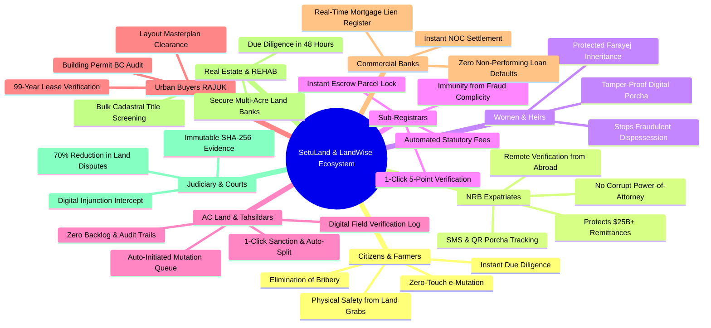

# SetuLand & LandWise: Stakeholder Personas & Societal Impact

> **Who Uses the Platform, How It Helps People, and the Macro-Socioeconomic Transformation of Bangladesh**  
> *Track P4: Digital Land Records, Verification & Cadastral Digitization (LandTech 2026)*

---

## 1. Executive Summary: The Human Dimension of the Land Crisis

In Bangladesh, land ownership is far more than an economic asset—it is family legacy, social dignity, retirement security, and ancestral roots. Yet, the land sector generates **over 75% of all civil and criminal litigations** clogging the nation's judicial system, entangling more than **3.2 million active court cases** and affecting tens of millions of citizens across generations.

The root cause has always been **structural opacity and institutional silos**:
- A hardworking citizen purchases a plot with life savings, only to find it was already secretly mortgaged to a commercial bank five years prior.
- An expatriate (NRB) toiling in the UK, USA, or Middle East sends remittances home to build a family house, only to discover an unscrupulous relative or broker forged a counterfeit deed and sold the ancestral land to multiple parties.
- A legitimate buyer registers a deed at the Sub-Registry office, but spends 6 to 18 months visiting the AC Land office, paying ৳15,000 to ৳80,000 in unauthorized "speed money" simply to get their name mutated on the Record of Rights.
- A widow or female heir is systematically excluded from inheritance porchas by dishonest brothers who alter handwritten revenue registers.

**SetuLand & LandWise** re-engineers this entire ecosystem into a transparent, deterministic digital pipeline that protects the weak, eliminates bribery, and restores trust in land ownership.

---

## 2. Comprehensive Stakeholder Ecosystem

---

## 3. Detailed Stakeholder Personas & How It Helps Them

---

### Persona 1: General Citizens, Farmers & Rural Smallholders

#### The Problem:
Rural families often depend on small agricultural parcels for their livelihood. When buying or dividing land, they face predatory middlemen (*dalals*), forged handwriting on ancient paper porchas, and violent land-grabbing syndicates. A single disputed plot can plunge a farming family into decades of poverty and legal misery.

#### How SetuLand Helps Them:
1. **Free Public Cadastral Search**: Any villager or family member can enter their Mouza and Dag number on a smartphone or Union Digital Center (UDC) terminal and see the clear legal status of the land.
2. **Instant Escrow Protection**: The moment a deed is signed, the seller's available balance is locked in the system. The seller cannot sell the same land to anyone else while the mutation is pending.
3. **Zero Bribery / No Dalal Extortion**: The citizen pays the statutory ৳1,170 e-mutation fee once at the Sub-Registry window. No one can demand unauthorized "speed money" because the process is automated and digitally tracked.

---

### Persona 2: Non-Resident Bangladeshis (NRBs) & Remittance Protection

#### The Problem:
Over **10 million Non-Resident Bangladeshis** send more than **$25 Billion annually** in foreign exchange back to Bangladesh. Their primary investment dream is purchasing land and building homes in their motherland. However, living abroad in London, New York, Toronto, Dubai, or Riyadh, they cannot physically guard their property. Dishonest relatives, brokers, and land syndicates frequently sell their land, fabricate fake power-of-attorney documents, or mortgage their property without their knowledge.

#### How SetuLand Helps Them:
1. **Remote 24/7 Global Access**: NRBs can inspect any plot in Bangladesh using the **DLRS National Cadastral Map Search** and **RAJUK WPLRS** from anywhere in the world.
2. **Instant Chain-of-Title Verification**: NRBs can independently verify the 80-year succession tree (CS ➔ SA ➔ RS ➔ BS) before wiring remittances.
3. **Real-Time Property Alerts**: NRBs can register their ancestral Dag numbers for automated SMS/email alerts if any deed registration, mutation, or mortgage is attempted on their land.

---

### Persona 3: Women Heirs, Widows & Vulnerable Family Members

#### The Problem:
Under Islamic inheritance law (*Farayej*), daughters, wives, and mothers are legally entitled to specific fractional shares of ancestral property. In practice, male relatives frequently manipulate handwritten paper khatians or register deeds claiming 100% of the land, completely dispossessing female heirs who lack the resources to fight prolonged legal battles.

#### How SetuLand Helps Them:
1. **Deterministic Inheritance Calculation**: SetuLand’s master khatian engine algorithmically enforces statutory Farayej share distributions based on verified NIDs.
2. **Cryptographic Tamper-Proofing**: A brother or uncle cannot pay a corrupt clerk to erase a sister's name from a paper register; any modification instantly breaks the SHA-256 hash chain and halts all transactions.
3. **Digital Notification**: All registered co-sharers receive automated digital notices whenever any co-sharer initiates a transfer or partition.

---

### Persona 4: Urban Property & Flat Buyers in Dhaka (RAJUK Zones)

#### The Problem:
Buying a plot or apartment in planned urban townships (Uttara, Gulshan, Banani, Purbachal, Nikunja) involves complex regulatory layers: 99-year government lease deeds, Building Construction (BC) permits, layout modifications, setback requirements, and allotment rules. Many buyers discover too late that their developer violated RAJUK masterplans or that the lease was never officially transferred.

#### How SetuLand Helps Them:
1. **RAJUK WPLRS Live Integration**: SetuLand interfaces directly with `wplrs.rajuk.gov.bd`, allowing buyers to inspect official allotment records, lease terms, and building clearance approvals in real time.
2. **AspMap GIS Verification**: Buyers can visually confirm the exact plot boundaries, road widths, and green buffer zones on the official RAJUK masterplan.
3. **Leasehold Escrow Clearance**: Ensures that all RAJUK transfer fees, government approvals, and mortgage clearances are verified before deed execution.

---

### Persona 5: Sub-Registrars & Deed Registry Staff (Ministry of Law)

#### The Problem:
Under the *Registration Act, 1908*, Sub-Registrars are legally obligated to execute deeds that appear prima facie complete. However, lacking real-time access to AC Land records, bank mortgage lists, or court injunctions, they inadvertently execute deeds on encumbered land. When the fraud is exposed, Sub-Registrars face Anti-Corruption Commission (ACC) investigations, public scandal, and legal suspension.

#### How SetuLand Helps Them:
1. **1-Click 5-Point Automated Verification**: In under 400 milliseconds, the Sub-Registrar’s dashboard scans the national database and validates identity, khatian balance, bank mortgage liens, civil court injunctions, and DC acquisition gazettes.
2. **Legal Immunity & Objective Auditing**: The system provides an unalterable digital log proving that every statutory check was verified before execution, shielding honest officers from false allegations.
3. **Automated Fee Calculation**: Eliminates all manual arithmetic and cash handling disputes for stamp duties (1.5%), registration fees (1.0%), local government tax (3.0%), capital gains tax (2.0%), and the bundled ৳1,170 e-mutation fee.

---

### Persona 6: Assistant Commissioners of Land (AC Land) & Tahsildars (Ministry of Land)

#### The Problem:
An Upazila AC Land office receives 500 to 1,500 manual mutation applications every month. Officers and Tahsildars are overwhelmed by paper dockets, manual field verification notes, and physical hearings. Paper files are frequently misplaced or damaged, creating multi-month backlogs and inviting public distrust.

#### How SetuLand Helps Them:
1. **Auto-Pushed Digital Queue**: Zero citizen applications required. Registered deeds arrive in the AC Land dashboard within seconds with verified metadata, stamp receipts, and seller balances.
2. **1-Click Digital Sanction**: Once the Tahsil field officer completes the ground check via the digital tablet interface, the AC Land reviews and approves the case with a single click.
3. **Automated Khatian Splitting**: The PostgreSQL trigger (`trg_execute_khatian_split`) instantly deducts the decimals from the seller, creates the buyer’s new child khatian, generates an immutable SHA-256 fingerprint, and publishes the official QR Porcha.

---

### Persona 7: Commercial Banks & Financial Institutions (Mortgage Credit)

#### The Problem:
Commercial banks hold over **৳1.4 Trillion in real estate mortgage loans**. Dishonest borrowers frequently pledge an original title deed to Bank A, obtain a "duplicate" copy by claiming the original was lost, and pledge the exact same property to Bank B or sell it to an innocent buyer. Banks face decades of litigation under the *Artha Rin Adalat Ain, 2003* to recover bad loans.

#### How SetuLand Helps Them:
1. **Instant Digital Lien Registry**: When a bank sanctions a loan, its mortgage lien is registered directly into SetuLand’s ledger.
2. **Sub-Registry Registration Block**: Any attempt by the borrower to sell or transfer the mortgaged land is automatically blocked across all Sub-Registry offices nationwide until the bank digitally issues a No-Objection Certificate (NOC).
3. **Real-Time Portfolio Monitoring**: Banks can run continuous automated health audits across their entire collateral portfolio.

---

### Persona 8: Real Estate Developers (REHAB) & Industrial Aggregators

#### The Problem:
Assembling 30 to 100 acres for an industrial park, special economic zone (BEZA), or residential housing project requires vetting hundreds of individual cadastral plots (Dags) owned by dozens of different families. A single disputed plot or hidden heirloom claim can freeze a ৳500 Crore development project.

#### How SetuLand Helps Them:
1. **Bulk Cadastral Screening**: Developers upload a list of 100+ Dag numbers and receive a comprehensive, color-coded risk report within minutes.
2. **High-Resolution Cadastral Maps**: Interactive vector polygon overlays from DLRS and RAJUK highlight clean plots in green, pending mutations in amber, and encumbered plots in red.
3. **Due Diligence Slashed from Months to 48 Hours**: Eliminates millions of Taka in broker fees and carrying costs.

---

### Persona 9: Judiciary, Civil Courts & Legal Advocates

#### The Problem:
Over **3.2 million civil court cases** remain backlogged in Bangladesh, with more than 75% directly related to land title disputes. Judges are forced to decipher decades-old handwritten paper documents, contradictory witness testimony, and forged seals.

#### How SetuLand Helps Them:
1. **Order 39 Rule 1 CPC Digital Intercept**: When a judge issues a temporary injunction, the court clerk enters the order into SetuLand. That Dag is immediately locked nationwide, preventing the defendant from liquidating the property during trial.
2. **Court-Admissible Cryptographic Evidence**: Digital deeds and porchas feature deterministic SHA-256 hashes compliant with the *Evidence Act, 1872 (as amended 2022)*, providing incontrovertible proof of title history.
3. **70% Drop in Future Litigations**: By preventing double selling and forged deeds at the point of origin, new land dispute filings will drop dramatically.

---

### Persona 10: District Administration & DC Land Acquisition Branch

#### The Problem:
When the government acquires land for national megaprojects (highways, bridges, economic zones, metro rail), corrupt syndicates fabricate deeds or rush through fraudulent mutations to claim 300% state compensation payouts (*Acquisition and Requisition of Immovable Property Act, 2017*).

#### How SetuLand Helps Them:
1. **Preliminary Section 4 Gazette Overlay**: The DC office logs preliminary acquisition notices into the platform, automatically freezing all private transfers on affected Dags.
2. **Zero Double-Compensation Fraud**: Compensation payouts are tied to biometric NIDs and cryptographic Khatians, ensuring public tax money reaches only genuine land owners.

---

## 4. Before vs. After: The Transformational Leap

| Operational Dimension | Traditional Manual System | With SetuLand & LandWise |
| :--- | :--- | :--- |
| **Due Diligence Duration** | 3 to 6 weeks of physical office visits | **< 30 seconds online** |
| **Mutation Process Duration** | 45 to 180 days (3 to 6 months) | **< 48 hours (Zero-touch automated)** |
| **Middleman / Bribery Cost** | ৳15,000 to ৳80,000 in "speed money" | **৳0 (Statutory ৳1,170 fee only)** |
| **Double Selling Fraud Rate** | Widespread across all 64 districts | **0% (Mechanically blocked in escrow)** |
| **Bank Mortgage Collateral Risk** | High non-performing loan default risk | **Near 0% (Real-time digital lien locks)** |
| **Document Integrity Verification** | Subjective, vulnerable to fake seals | **Mathematical (SHA-256 hash avalanche)** |
| **Urban RAJUK Lease Verification** | 2 to 3 months of manual desk tracking | **Instant live integration via WPLRS API** |
| **National Cadastral Map Access** | Physical paper sheets stored in record rooms | **Nationwide 64-district digital map search** |
| **Civil Court Case Backlog** | 3.2M+ cases clogging judiciary | **Expected 70% reduction in new filings** |
| **Citizen Peace of Mind** | Extreme anxiety and vulnerability | **Total legal certainty and investment security** |
