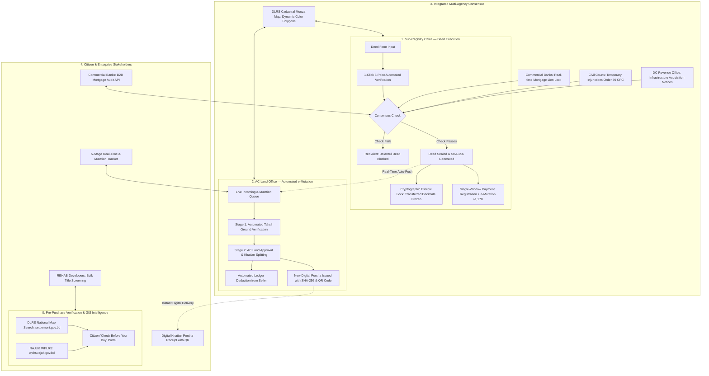

# What It Does: System Architecture & Capabilities
### SetuLand (সেতু-ল্যান্ড) & LandWise Cadastral Platform
#### LandTech 2026 Innovation Hackathon | Track P4: Digital Land Records, Verification & Digitization

---

## 1. The Crisis: Why This System Had to Be Built

Land administration in Bangladesh has historically suffered from deep institutional fragmentation between two independent government ministries:
1. **The Directorate of Registration (Ministry of Law, Justice and Parliamentary Affairs):** Administers deed execution, stamp duties, and registration under *The Registration Act, 1908*.
2. **The Ministry of Land / AC Land Offices & DLRS:** Maintains the official Record of Rights (RoR / Khatian / Porcha), administers mutations (নামজারি) under *The State Acquisition and Tenancy Act, 1950*, and conducts nationwide cadastral surveys through the Directorate of Land Records and Surveys (DLRS).
3. **Urban Development Authorities (e.g., RAJUK - Ministry of Housing and Public Works):** Manages planned urban townships, leasehold allotments (99-year leases), building permits, and zoning in the capital mega-region.

```
       [MINISTRY OF LAW]                [MINISTRY OF LAND]           [HOUSING & PUBLIC WORKS]
     Sub-Registry Offices                AC Land / DLRS                     RAJUK (Dhaka)
              │                                 │                                 │
     Deed Execution & Stamps            Khatian / RoR / Mutation           Lease Deeds & BC Permits
              │                                 │                                 │
              └────────────── ❌ ZERO COMMUNICATION ──────────────────────────────┘
                         • 45–180 Day Vulnerability Window
                         • 3.2M+ Active Civil Litigations (75% of all court cases)
                         • Unchecked Double-Selling & Fake Deeds
                         • Bank Mortgages & Court Injunctions Hidden
```

### The Problem P4 Gap
* **The "Zero-Communication" Lag:** When a citizen purchases land, they execute and register the deed at the Sub-Registry Office. However, the deed registration does **not** communicate with or update the land record at the AC Land office or urban authority.
* **The 45–180 Day Vulnerability Window:** The buyer must separately visit the AC Land office, submit an independent mutation application, pay fees a second time, and wait months for manual verification. During this lag, the seller’s name remains on the official Khatian as the undisputed legal owner.
* **The Double-Selling Loophole:** Unscrupulous sellers exploit this window by re-selling the exact same plot to multiple buyers using counterfeit deeds or un-updated Khatians. Over **75% of civil litigations in Bangladesh courts (over 3.2 million active cases)** stem directly from this disjointed workflow.
* **Blind Encumbrance Execution:** Sub-Registrars execute deeds on plots mortgaged to commercial banks, subject to civil court stay orders (*Order 39 Rule 1 CPC*), or gazetted by the Deputy Commissioner (DC) for national infrastructure projects, because registries lack real-time visibility.
* **Urban vs. Cadastral Division:** Capital city plots under RAJUK (Uttara, Gulshan, Banani, Purbachal) have separate lease records, layout masterplans, and building construction clearances that traditional rural Mouza systems cannot verify.

---

## 2. The Solution: Zero-Touch Interoperability

**SetuLand (সেতু-ল্যান্ড)** creates a unified, real-time registry and consensus engine connecting the Sub-Registry Office, AC Land Office, Commercial Banks, Civil Courts, the Deputy Commissioner’s Revenue Branch, DLRS Cadastral Map Search, and the RAJUK Web-based Plot Land Record System (WPLRS).



---

## 3. Core System Capabilities & Features

### Feature 1: 1-Click 5-Point Automated Verification
Before a Sub-Registrar executes any deed, the system conducts a comprehensive real-time consensus check in under 400ms:
1. **Ownership & Available Area:** Verifies that the seller's National ID matches the master Khatian, and confirms that `(totalAreaDecimals - lockedAreaDecimals) >= saleAreaDecimals`.
2. **Bank Mortgage Lien:** Scans all scheduled commercial banks (e.g., Sonali Bank, City Bank, BRAC Bank) to ensure no active mortgage lien is placed on the parcel.
3. **Judicial Injunction Status:** Queries the Civil Court registry for pending litigation or temporary injunctions (*Order 39 Rule 1 CPC*).
4. **Government Land Acquisition:** Verifies with the Deputy Commissioner (DC) Office that the parcel has not been gazetted for state infrastructure (*Land Acquisition Act 2017*).
5. **Cryptographic Integrity:** Recomputes the SHA-256 hash of the parcel's title chain history to verify zero database tampering.

If any check fails, the deed is immediately blocked with an un-bypassable **Red Alert Modal** detailing the specific statutory conflict.

---

### Feature 2: Automated Land Escrow Lock (Anti-Double-Selling)
- The millisecond a deed is sealed at the Sub-Registry, SetuLand automatically increments `lockedAreaDecimals` on the seller's Khatian record.
- **Example:** If Seller Karim Mia owns 10 decimals on Dag #405 and sells 7 decimals to Buyer Rahim, 7 decimals are immediately locked in escrow. The remaining transferable balance becomes 3 decimals.
- If Karim attempts to register another deed for 5 decimals an hour later at any other Sub-Registry office, the system detects `availableArea (3) < requestedArea (5)` and triggers a hard lock, completely eliminating double-selling fraud.

---

### Feature 3: Zero-Touch e-Mutation Auto-Push
- Citizens no longer need to fill out secondary applications, travel to the Upazila Land Office, or pay intermediary brokers.
- Sealing the deed at the Sub-Registry automatically creates a formal case in the AC Land queue with status `AUTO_INITIATED`.
- Single-window payment at the Sub-Registry collects both registration stamp duties and the official ৳1,170 e-mutation fee, eliminating double payment.

---

### Feature 4: Live Integration with RAJUK WPLRS (Web-based Plot Land Record System)
SetuLand integrates directly with the Capital Development Authority’s official portal (`https://wplrs.rajuk.gov.bd/wplrs/MapViewer.aspx?mapcode=3_0`):
- **Urban Township Coverage:** High-density, high-value planned areas in Dhaka including:
  - Uttara Residential Model Town (Phases 1, 2, and 3)
  - Gulshan, Banani, and Baridhara Diplomatic Zones
  - Purbachal New Town (Sectors 1–30)
  - Nikunja 1 & 2, Dhanmondi, and Badda Re-settlement
- **AspMap GIS Engine Interoperability:** Reverse-proxies dynamic map tiles, layer configurations (roads, plots, utilities, green spaces), coordinate bounding boxes, and zoom controls.
- **Leasehold Due Diligence:** Audits 99-year government lease terms, Building Construction (BC) permits, layout modifications, setback requirements, and allotment transfer permissions.

---

### Feature 5: Live Integration with DLRS Settlement Map Search
SetuLand connects to the national cadastral mapping engine of the Directorate of Land Records and Surveys (`https://settlement.gov.bd/map/mapsearch`):
- **64-District Nationwide Coverage:** Access to all 8 administrative divisions (Dhaka, Chittagong, Rajshahi, Khulna, Barisal, Sylhet, Rangpur, Mymensingh).
- **Hierarchical Cadastral Drill-down:**
  $$\text{Division} \longrightarrow \text{District} \longrightarrow \text{Upazila / Thana} \longrightarrow \text{Mouza} \longrightarrow \text{Sheet No.} \longrightarrow \text{Dag (Plot) No.}$$
- **Historical Survey Lineage:** Allows side-by-side comparison across Cadastral Survey (CS 1940), State Acquisition Survey (SA 1962), Revenue Survey (RS 1985), City/BS Survey (2012), and modern Bangladesh Digital Survey (BDS).
- **Vector & Raster Mouza Overlays:** Seamlessly render interactive plot boundaries with color-coded legal status.

---

### Feature 6: Deterministic SHA-256 Ledger & Tamper Proofing
- Every deed and newly issued Khatian (Porcha) is signed using deterministic SHA-256 hashing based on:
  $$\text{Payload} = \text{DeedNo} \mid \text{DeedYear} \mid \text{SellerNID} \mid \text{BuyerNID} \mid \text{DagNo} \mid \text{AreaDecimals}$$
- Any post-registration tampering (e.g., manually editing 7.0 decimals to 9.0 decimals in a database) produces a completely different 64-character hash avalanche, instantly flagged as forged.
- The built-in **Tamper Simulator** lets judges and officials test this live by altering plot area or owner name and observing instant verification failure.

---

### Feature 7: Citizen Portal & "Check Before You Buy"
- **5-Stage Live e-Mutation Tracker:** Citizens enter their deed tracking number (`EM-2026-XXXXX`) to follow live progress:
  1. *Deed Registered & Escrow Locked (Sub-Registry)*
  2. *Auto-Pushed to AC Land Queue*
  3. *Union Tahsil Ground Inquiry Complete*
  4. *AC Land Formal Approval & Khatian Splitting*
  5. *DCR & Digital Porcha Issued with Dynamic QR*
- **Check Before You Buy Inspector:** Prospective buyers can look up any Dag/Khatian before paying booking deposits to review chain of title, survey records, and liens.

---

### Feature 8: Multi-Stakeholder Consensus Simulator
Enables real-time toggling of external conditions for testing:
- **Commercial Bank:** Place or release a mortgage lien (e.g., Sonali Bank Savar Branch, ৳50,00,000 loan).
- **Civil Court:** Issue or vacate a temporary injunction (*Order 39 Rule 1 CPC*).
- **DC Revenue Office:** Toggle government land acquisition notices (*Notice Under Section 4(1)*).
- **Sub-Registry Response:** Immediately reflects the updated legal status across all verification queries.

---

### Feature 9: Office-Grade Printable Documents
- Produces official, high-contrast, print-formatted receipts:
  - **Sub-Registry Registered Deed Receipt** with automated tax breakdown and QR verification.
  - **Digital Porcha (Khatian Record of Rights)** with Khatiyan serial, land class, owner lineage, and QR code.
- Embedded with mandatory compliance watermarks: `"SYNTHETIC DUMMY RECORD — LANDTECH 2026"` for complete hackathon safety.

---

### Feature 10: 64-District Cadastral Intelligence & Land Valuation Engine
- Interactive nationwide GIS mapping across all 64 districts and 8 administrative divisions of Bangladesh.
- Real-time land valuation index (BDT/Katha) and historical YoY growth rates.
- Comprehensive directories of Upazilas, Pourashavas, educational institutions, healthcare hubs, and major infrastructure corridors.
